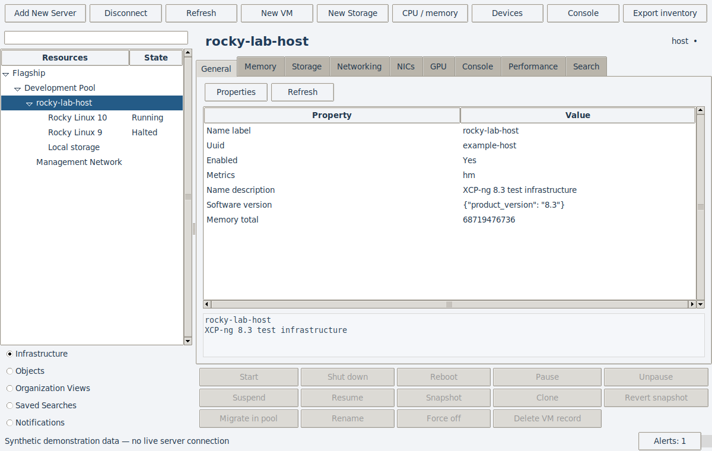
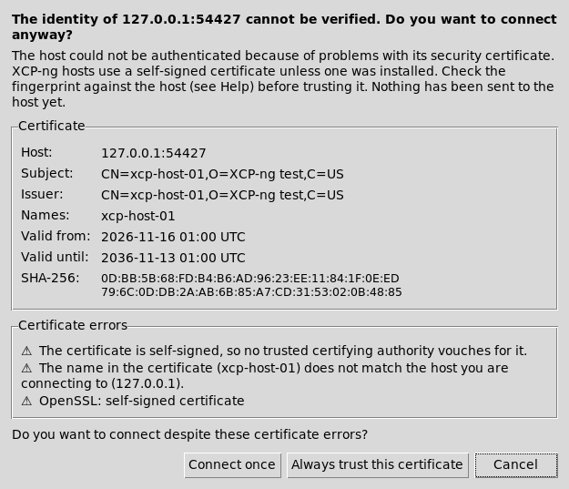
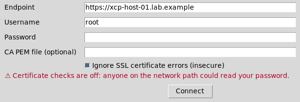
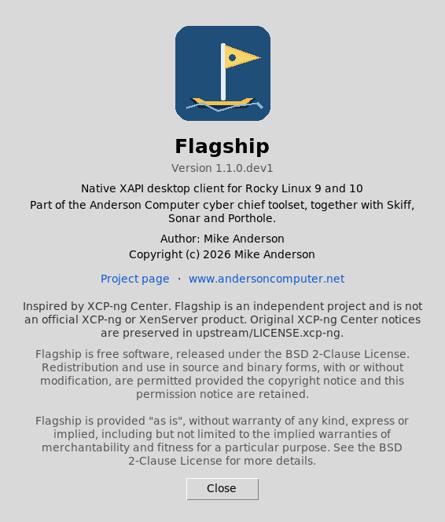

# Flagship

[](https://github.com/mike0615/flagship/releases)
[](https://github.com/mike0615/flagship/releases)
[](https://github.com/mike0615/flagship/releases)
[](LICENSE)

> **Formerly XenAdmin Rocky.** Version 1.1.0.dev1 renamed the app, package and
> commands to `flagship` and `flagship-recovery`. Upgrading with dnf replaces
> `xenadmin-rocky`, keeps the old commands as symlinks, and copies your
> operation journals on first run (see [Upgrading](#upgrading-from-xenadmin-rocky)).

Native Linux desktop management client for XAPI pools, for **Rocky Linux 9 and
10**, in the spirit of XCP-ng Center on Windows. Flagship is part of the
Anderson Computer cyber chief toolset, together with
[Skiff](https://github.com/mike0615/skiff),
[Sonar](https://github.com/mike0615/sonar) and
[Porthole](https://github.com/mike0615/porthole).

It is an independent project maintained by Mike Anderson; it is not an official
XCP-ng or XenServer product.

**Status: development candidate 1.3.0.dev1.** There is no qualified v1.0
release yet. A successful RPM build is not proof of working pool management or
an offline install. See [qualification status](docs/QUALIFICATION.md) and the
[feature matrix](docs/FEATURE_MATRIX.md).



The [portable-image and console guide](docs/PORTABLE_IMAGES.md) covers OVA/qcow2,
docked consoles and Virt Viewer.

The new [Center-style interface guide](docs/CENTER_INTERFACE.md) describes the
object-specific tables, navigation, wizard, NFS/private-network creation, host
operations, RRD history and XVA transfer workflows. Full Windows feature parity
is still in development.

The interface uses a resource tree, inventory tabs and VM action buttons.
Python/Tk and native Linux image/viewer tools replace WinForms, .NET Framework, COM and
Windows installers. TLS certificate and hostname verification are on by
default. Self-signed XCP-ng hosts can be trusted per certificate, or, for a lab,
checked insecurely (see [Self-signed XCP-ng certificates](#self-signed-xcp-ng-certificates)).
Passwords are not saved.

## Features

- **Pool connection** with TLS certificate and hostname verification by default,
  an optional CA PEM file, a trust-this-certificate prompt (SHA-256 pinning)
  for self-signed hosts, and an explicit insecure mode. Passwords stay in
  process memory and are never written to disk.
- **Resource tree** of pools, hosts, VMs, templates, snapshots, storage and
  networks, with a live name/UUID filter.
- **Contextual inventory tabs**, including Memory, NICs, GPU, snapshots, search, tasks and alerts; sortable tables replace raw JSON.
- **VM lifecycle**: start, shutdown, reboot, force off, pause/unpause,
  suspend/resume, clone, snapshot, revert, rename, same-pool migrate and
  delete-record (disks retained), each confirmed before the server is called.
- **New VM wizard** for installer templates and installed-template disk copies,
  with selected storage, network and optional ISO, plus confirmed task outcomes.
- **Halted-VM editor** for vCPU and fixed-memory settings.
- **Device management**: disk/DVD/NIC add, attach, grow, rename, detach, delete
  and connect/move.
- **Authenticated VM console** (development TLS RFB viewer).
- **Private operation journals** under `~/.local/state/flagship/journals/`, with
  a read-only history view and `flagship-recovery` UUID inspection after an
  interruption. Journals never replay changes automatically.
- **Help and About**: `F1` or Help ▸ Flagship Help opens the offline chapter
  index (no browser or network). Help ▸ About Flagship shows the version,
  toolset, project link, license and credits.
- **Inventory export** to local JSON, with selected credential fields redacted.

## Build this candidate

The source tree is 1.3.0.dev1. Build and install the matching RPM as described in
[BUILD.md](docs/BUILD.md). RPMs and dependency-complete offline archives produced
for this work are under `dist/1.3.0.dev1/el9` and `dist/1.3.0.dev1/el10`.
The release links below install the 1.3.0.dev1 development prerelease.

## Published releases / Download

Two dist-tagged noarch RPMs are provided. Use the one that matches your release.
Runtime dependencies (`python3`, `python3-tkinter`, `ca-certificates`, `qemu-img`, `virt-viewer`) are in
the stock BaseOS/AppStream repos. You don't need EPEL, CRB or pip.

Download the RPMs from the
[1.3.0.dev1 release](https://github.com/mike0615/flagship/releases/tag/v1.3.0-dev.1), or
install directly:

```bash
# Rocky Linux 9
sudo dnf install https://github.com/mike0615/flagship/releases/download/v1.3.0-dev.1/flagship-1.3.0-0.1.dev1.el9.noarch.rpm
# Rocky Linux 10
sudo dnf install https://github.com/mike0615/flagship/releases/download/v1.3.0-dev.1/flagship-1.3.0-0.1.dev1.el10.noarch.rpm
```

Then start **Flagship** from the application menu, or run `flagship`.
Verify downloads with `SHA256SUMS` from the release. Remove with
`sudo dnf remove flagship`.

This is an unsigned development candidate. Authenticate the download yourself
and do not treat it as a signed stable release. For a fully disconnected
desktop, build the matching airgap bundle as described in
[INSTALL.md](docs/INSTALL.md) and [BUILD.md](docs/BUILD.md).

## Upgrading from XenAdmin Rocky

If you already have `xenadmin-rocky` installed, installing the Flagship RPM
replaces it (`Obsoletes:` / `Provides:`). The `xenadmin-rocky` and
`xenadmin-rocky-recovery` commands remain as symlinks to `flagship` and
`flagship-recovery`.

On first run, if `~/.local/state/flagship` does not exist yet, Flagship copies
`~/.local/state/xenadmin-rocky` (operation journals) and `~/.config/xenadmin-rocky`
if that directory is present. The originals are left untouched.

## Use

```bash
flagship                  # open the desktop client
flagship --help
flagship --version
flagship --smoke-test     # create the UI, then exit (needs a display)
flagship --insecure       # pre-tick "Ignore SSL certificate errors" (lab only)
flagship-recovery --help  # read-only journal history and UUID inspection
```

`python3 -m flagship` and `python3 -m xenadmin_rocky` also start the client.

Click **Connect** and enter the HTTPS address of the pool coordinator
(for example `https://pool.example.internal`), your XAPI username and password,
and optionally a PEM CA file. Start with a test pool and a read-only account.
The desktop requires a graphical session; the application is not a web server.

Press `F1` in the app for the full help. The same chapters are in `docs/`.

## Self-signed XCP-ng certificates

XCP-ng hosts ship with a self-signed certificate. You have three options, from
safest to least safe:

1. **CA PEM file (optional)**: point it at the host's own certificate
   (`openssl s_client -connect xcp-host:443 -showcerts </dev/null 2>/dev/null | openssl x509 > ~/xcp-host.pem`).
   Full verification, including the host name.
2. **Trust prompt**: leave the CA field empty and connect. Flagship stops
   before sending the password and shows the subject, issuer, validity dates
   and SHA-256 fingerprint, with **Connect once**, **Always trust this
   certificate** and **Cancel**. Saved pins live in
   `~/.config/flagship/known_certs.json` (0600) per `host:port`. A pinned host
   is accepted only while its fingerprint matches. A changed certificate gets
   a loud warning and a new prompt and is never accepted automatically. The
   pins cover the XML-RPC connection and the VM console. You can manage them
   under **Tools ▸ Trusted certificates…**.
3. **Ignore SSL certificate errors (insecure)**: a checkbox in the connect
   dialog (or `flagship --insecure`) that turns off verification for that
   connection. The status bar shows **Insecure TLS** while you're connected.

`flagship-recovery inspect` takes `--ca-file`, `--pin SHA256`, `--insecure` and
`--no-saved-pins`. For details, see [TLS_CERTIFICATES.md](docs/TLS_CERTIFICATES.md)
(also in the in-app help).

| Trust prompt | Connect dialog |
|---|---|
|  |  |



## Run from source

On a connected Rocky desktop, install `python3 python3-tkinter ca-certificates qemu-img virt-viewer`.
From this directory:

```bash
python3 -m flagship
python3 -m unittest discover -s tests -v
```

For a GUI construction check, use
`xvfb-run -a python3 -m flagship --smoke-test` where available.
A GUI smoke test is not a hypervisor workflow test.

## Documentation

- [User guide and built-in help](docs/USER_GUIDE.md)
- [Installation and airgap operation](docs/INSTALL.md)
- [Build instructions](docs/BUILD.md)
- [Source analysis](docs/SOURCE_ANALYSIS.md)
- [Feature matrix and limitations](docs/FEATURE_MATRIX.md)
- [Security and troubleshooting](docs/OPERATIONS.md)
- [Persistent history and recovery](docs/RECOVERY.md)
- [Self-signed XCP-ng certificates](docs/TLS_CERTIFICATES.md)
- [Release notes](docs/RELEASE_NOTES.md)
- [Qualification and evidence](docs/QUALIFICATION.md)

## Build the RPMs

Official release builds use the project's `scripts/build-rpm.sh` on a connected
builder with Bash, Git, Podman and network access to Rocky repositories
(see [BUILD.md](docs/BUILD.md)):

```bash
./scripts/build-rpm.sh 9
./scripts/build-rpm.sh 10
```

Output goes under `dist/1.3.0.dev1/el9` and `dist/1.3.0.dev1/el10`: the noarch
RPM, the source RPM, the source tarball and `SHA256SUMS`. Build on the same
Rocky major as the target; never mix dependency sets across majors.

## Tests

```bash
python3 -m unittest discover -s tests -v
xvfb-run -a python3 -m flagship --smoke-test
```

## License

BSD 2-Clause. See [LICENSE](LICENSE). Copyright (c) 2026 Mike Anderson.

Original application copyright/license notices are preserved in
`upstream/LICENSE.xcp-ng`. The supplied Windows source is inventoried in
`upstream/SHA256SUMS`; this repository contains the new native client, not the
Wine wrapper found in the older private fork.
