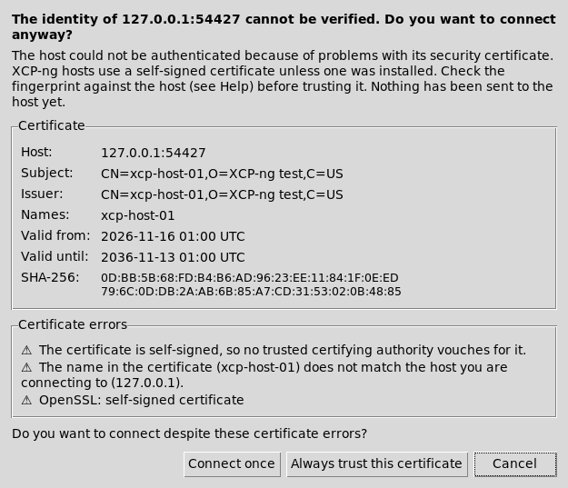
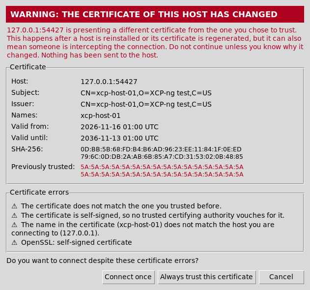
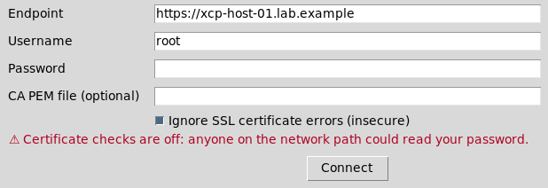

# Self-signed XCP-ng certificates

XCP-ng creates a self-signed TLS certificate when a host is installed. Flagship
checks certificates by default, so the first connection to a host like that is
refused until you choose how to trust it. There are three ways to do that, from
safest to least safe.

## 1. CA PEM file (verified)

Point **CA PEM file (optional)** in the connect dialog at the certificate that
signed the host's certificate. For a self-signed host, use the host's own
certificate. Fetch it from your Rocky desktop:

```bash
openssl s_client -connect xcp-host:443 -showcerts </dev/null 2>/dev/null \
  | openssl x509 > ~/xcp-host.pem
```

Type the endpoint the way the certificate names the host. If you connect by IP
and the certificate only has a host name, verification fails with a name
mismatch. Use the name, or use the trust prompt below.

## 2. Trust prompt (pinned fingerprint)

Leave the CA field empty and connect. If the certificate can't be verified
(self-signed, unknown CA, name mismatch or expired), Flagship stops **before
sending your password** and shows the certificate's subject, issuer, validity
dates and SHA-256 fingerprint.



- **Connect once** accepts this exact certificate for this session only.
- **Always trust this certificate** saves the fingerprint for that
  `host:port` in `~/.config/flagship/known_certs.json` (mode 0600, directory
  0700).
- **Cancel** (the default) does not connect.

Before you trust it, compare the fingerprint with the one on the host's console
or over SSH:

```bash
openssl x509 -in /etc/xensource/xapi-ssl.pem -noout -fingerprint -sha256
```

On later connections a pinned host is accepted when the certificate's SHA-256
fingerprint matches the pin, even though it is self-signed or the name doesn't
match. The pin is checked right after the TLS handshake, before any request,
credential or console session cookie is sent. The same check covers the
XML-RPC connection and the VM console (a console on another pool member with
its own self-signed certificate gets its own prompt).

If a pinned host presents a **different** certificate, Flagship never accepts
it silently. It shows **WARNING: THE CERTIFICATE OF THIS HOST HAS CHANGED**
with the new and previously trusted fingerprints, and asks again. Expect this
after a reinstall or a certificate regeneration. If you didn't change
anything, don't continue.



Remove saved pins with **Tools ▸ Trusted certificates…**.

## 3. Ignore SSL certificate errors (insecure)

The connect dialog has **Ignore SSL certificate errors (insecure)**. It turns
off all certificate checks for that one connection, covering both the XML-RPC
connection and the console. While you're connected, the status bar shows a red
**Insecure TLS** marker. Anyone on the network path could read your password,
so use it only on an isolated lab network. Nothing is saved. `flagship
--insecure` opens the connect dialog with the box already ticked.



## Recovery command

`flagship-recovery inspect` has the same options:

```bash
flagship-recovery inspect --endpoint https://xcp-host --username root \
  --kind VM --uuid <uuid> --ca-file ~/xcp-host.pem      # verified
  ... --pin AB:CD:...                                    # pinned SHA-256
  ... --insecure                                         # no verification
```

By default it also accepts certificates you chose to always trust in the GUI.
Add `--no-saved-pins` to ignore them. An untrusted certificate is refused, and
the command prints its details and fingerprint so you can rerun it with `--pin`.
